# Structure PLP-SLAM: Efficient Sparse Mapping and Localization using Point, Line and Plane for Monocular, RGB-D and Stereo Cameras

## Related Papers:

[1] F. Shu, et al. "Structure PLP-SLAM: Efficient Sparse Mapping and Localization using Point, Line and Plane for Monocular, RGB-D and Stereo Cameras". IEEE International Conference on Robotics and Automation (ICRA), 2023. (https://arxiv.org/abs/2207.06058) **updated arXiv v3 with supplementary materials.**

[2] F. Shu, et al. "Visual SLAM with Graph-Cut Optimized Multi-Plane Reconstruction." International Symposium on Mixed and Augmented Reality (ISMAR, poster). IEEE, 2021. (https://arxiv.org/abs/2108.04281)

[3] Y. Xie, et al. "PlaneRecNet: Multi-Task Learning with Cross-Task Consistency for Piece-Wise Plane Detection and Reconstruction from a Single RGB Image." British Machine Vision Conference (BMVC), 2021. (https://arxiv.org/abs/2110.11219)

## Video

<p align="center">
  <a href="video/ICRA23_0006.mp4">
    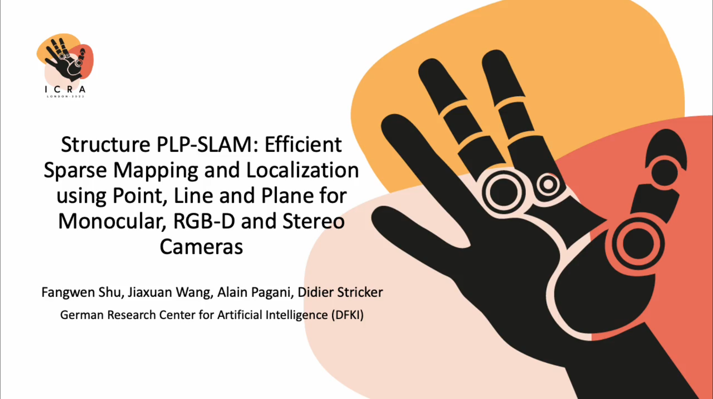
  </a>
</p>

<p align="center">
Click the image above to download and watch the ICRA 2023 demonstration.
</p>


## The System Workflow: 

<p align="center">
  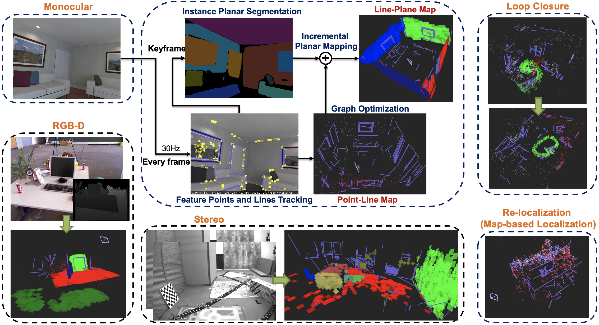
</p>

## Qualitative Results

### Monocular

<p align="center">
  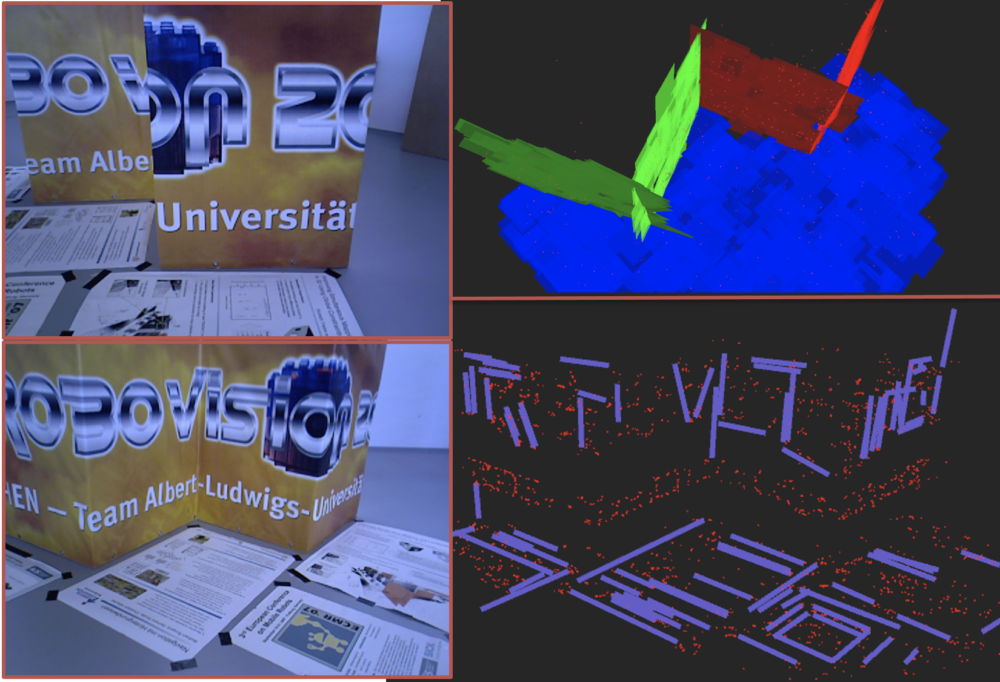
  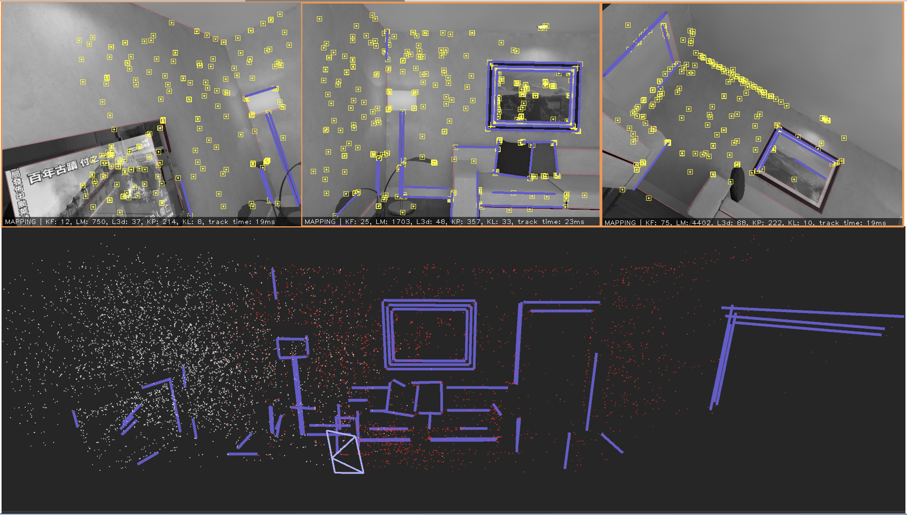
</p>

<p align="center">
  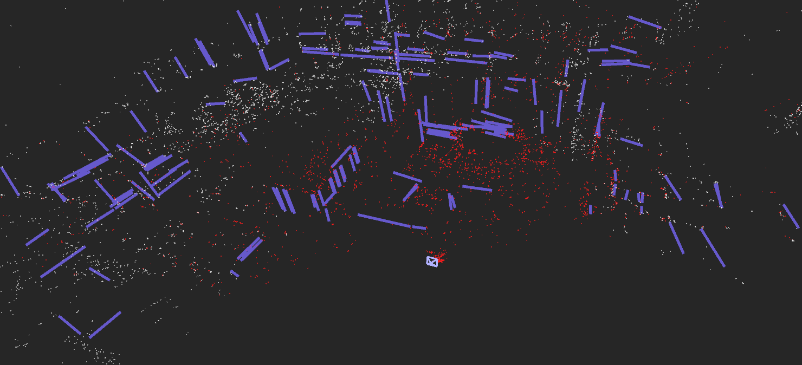
  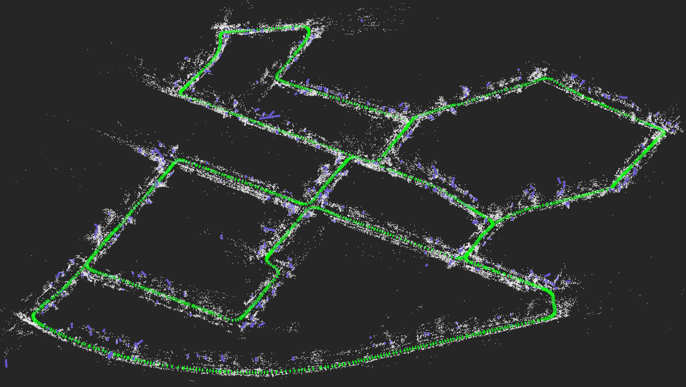
</p>

*TUM RGB-D • ICL-NUIM • EuRoC MAV • KITTI*

---

### RGB-D

<p align="center">
  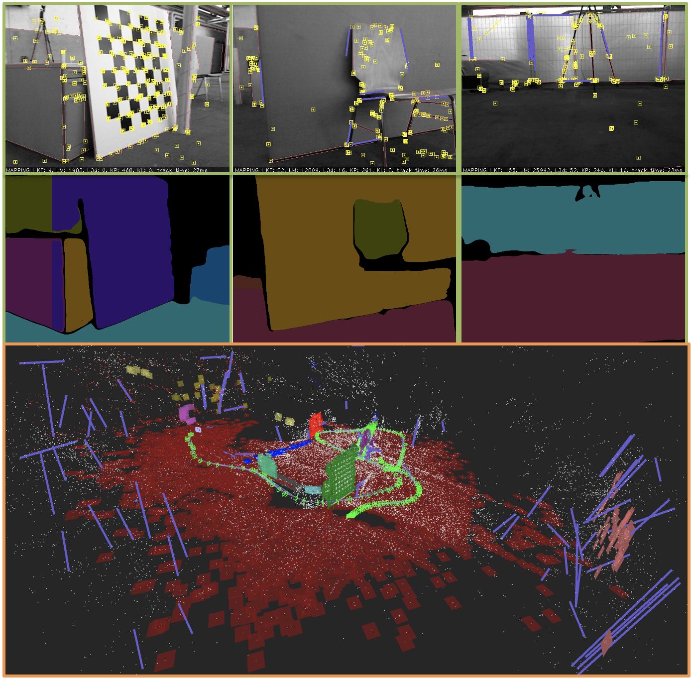
  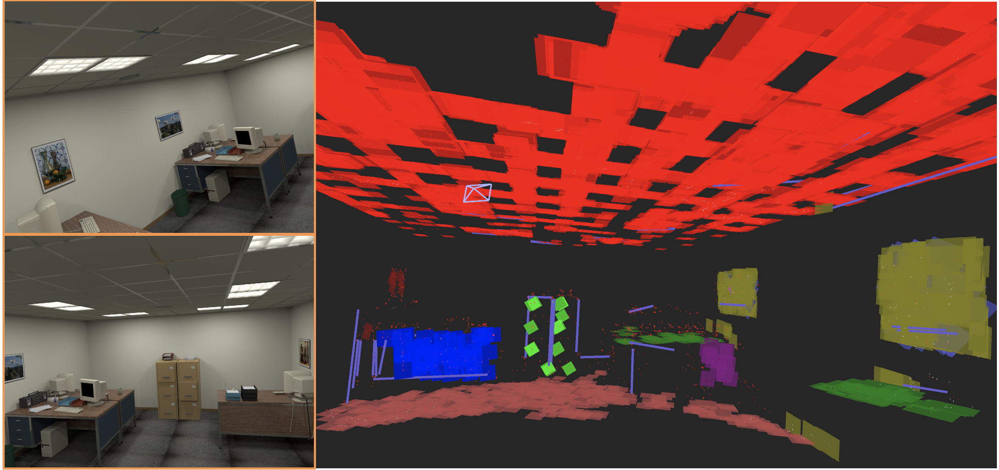
</p>

*TUM RGB-D • ICL-NUIM*

---

### Stereo

<p align="center">
  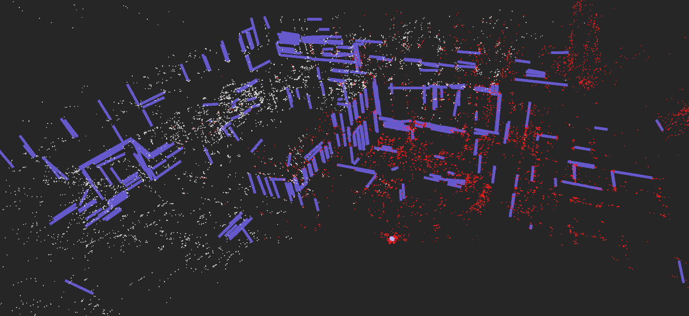
  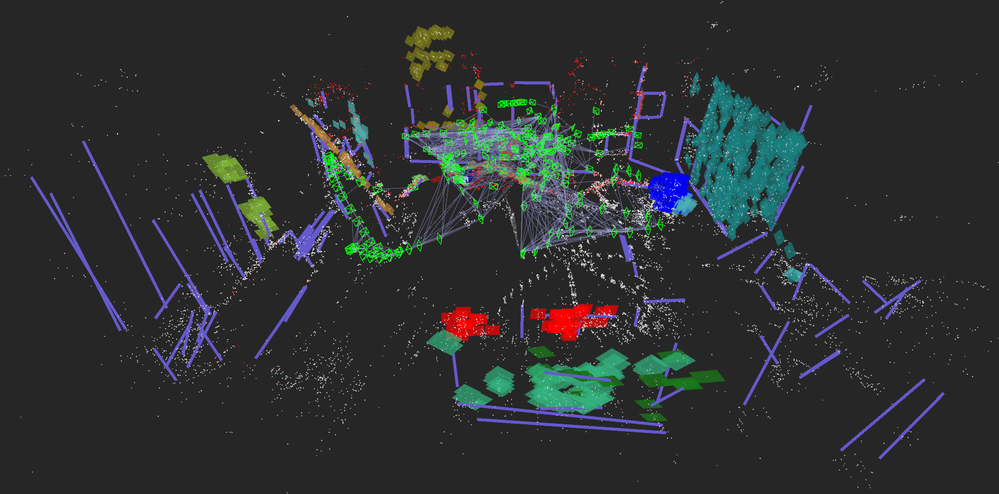
</p>

*EuRoC MAV*

## Build with PangolinViewer (Default)

### Documentation

The structure-plp-slam code is based on a relatively old version of OpenVSLAM (early 2021).

See the corresponding v0.3.9 documentation:

    https://stella-cv.readthedocs.io/en/0.3.9/example.html 

### Remarks

* Point-Line SLAM is generalized. Suppose it can be conducted on all kind of data image sequences.
* For running Planar SLAM, segmentation needs to be done beforehand (see details in below).
* ORB vocabulary is already attached to this repository, see: ./orb_vocab/

### Dependencies:

* **Ubuntu 24.04** was tested.
* **OpenCV**: version 3.4.16 was tested, for utilizing line segment (LSD + LBD).
* **g2o**: can install the latest version, the recent commit (July 12, 2026) was tested.
* **Eigen3**: version 3.4.1 was tested, must be version 3.
* **DBoW2**: please download the version from ondrive (https://1drv.ms/u/s!Atj7rBR0X5zagZwcFs1oIqXeV5r4Cw?e=pbnNES), latest version from github is not tested.
* **Graph-Cut RANSAC**: its C++ implementation was integrated into the SLAM system, under BSD license. See https://github.com/danini/graph-cut-ransac.

* This project does **not** support using **ROS** and **Docker**, at least we haven't tested, for now.

* An additional plane detector:

    This work take PlaneRecNet [3] as the instance planar segmentation CNN (only instance segmentation is used, predicted depth is not used by far). Example segmentation images for different datasets will be provided with a downloading link, see section below -> **Run Point-Plane SLAM**.

    You could also segment images yourself, code please see: https://github.com/EryiXie/PlaneRecNet

### Build using CMake:

```
mkdir build && cd build

cmake \
    -DBUILD_WITH_MARCH_NATIVE=ON \
    -DUSE_PANGOLIN_VIEWER=ON \
    -DUSE_SOCKET_PUBLISHER=OFF \
    -DUSE_STACK_TRACE_LOGGER=ON \
    -DBOW_FRAMEWORK=DBoW2 \
    -DBUILD_TESTS=OFF \
    ..

make -j4
```

(or, highlight and filter (gcc) compiler messages)
```
make -j4 2>&1 | grep --color -iP "\^|warning:|error:|"
make -j4 2>&1 | grep --color -iP "\^|error:|"
```

### Command options to run the example code on standard dataset, e.g. TUM-RGBD:

```
$ ./build/run_tum_rgbd_slam
Allowed options:
  -h, --help             produce help message
  -v, --vocab arg        vocabulary file path
  -d, --data-dir arg     directory path which contains dataset
  -c, --config arg       config file path
  --frame-skip arg (=1)  interval of frame skip
  --no-sleep             not wait for next frame in real time
  --auto-term            automatically terminate the viewer
  --debug                debug mode
  --eval-log             store trajectory and tracking times for evaluation
  -p, --map-db arg       store a map database at this path after SLAM
```

## Known Issues
* System crash right after initializing SLAM (a segmentation error due to g2o CSparse solver) has been fixed.

* Visualization issue (https://github.com/PeterFWS/Structure-PLP-SLAM/issues/8) that the camera is not following the right tracking path, appears to be resolved, recent tested on Ubuntu24.04.


## Run Standard SLAM with Standard Datasets

<details>
<summary><b>TUM RGB-D / KITTI / EuRoc MAV</b> (Monocular / RGB-D / Stereo Examples)</summary>

### (1) TUM-RGBD dataset (monocular/RGB-D):

```
./build/run_tum_rgbd_slam \
-v ./orb_vocab/orb_vocab.dbow2 \
-d /data/TUM_RGBD/rgbd_dataset_freiburg3_long_office_household \
-c ./example/tum_rgbd/TUM_RGBD_mono_3.yaml
```

### (2) KITTI dataset (monocular/stereo):

```
./build/run_kitti_slam \
-v ./orb_vocab/orb_vocab.dbow2 \
-d /data/KITTI/odometry/data_odometry_gray/dataset/sequences/00/ \
-c ./example/kitti/KITTI_mono_00-02.yaml
```

### (3) EuRoC MAV dataset (monocular/stereo)

```
./build/run_euroc_slam \
-v ./orb_vocab/orb_vocab.dbow2 \
-d /data/EuRoC_MAV/MH_01_easy/mav0 \
-c ./example/euroc/EuRoC_mono.yaml
```
</details>

## Run Point-Line SLAM

<details>
<summary><b>TUM RGB-D / KITTI / EuRoc MAV</b> (Monocular / RGB-D / Stereo Examples)</summary>

### (1) TUM RGB-D (monocular/RGB-D)

```
./build/run_tum_rgbd_slam_with_line \
-v ./orb_vocab/orb_vocab.dbow2 \
-d /data/TUM_RGBD/rgbd_dataset_freiburg3_long_office_household \
-c ./example/tum_rgbd/TUM_RGBD_mono_3.yaml
```

### (2) ICL-NUIM (monocular/RGB-D)

```
./build/run_tum_rgbd_slam_with_line \
-v ./orb_vocab/orb_vocab.dbow2 \
-d /data/ICL_NUIM/traj3_frei_png \
-c ./example/icl_nuim/mono.yaml
```

### (3) EuRoc MAV (monocular/stereo)

```
./build/run_euroc_slam_with_line \
-v ./orb_vocab/orb_vocab.dbow2 \
-d /data/EuRoC_MAV/MH_04_difficult/mav0 \
-c ./example/euroc/EuRoC_mono.yaml
```

### (4) KITTI (monocular/stereo)

```
./build/run_kitti_slam_with_line \
-v ./orb_vocab/orb_vocab.dbow2 \
-d /data/KITTI/odometry/data_odometry_gray/dataset/sequences/00/ \
-c ./example/kitti/KITTI_mono_00-02.yaml
```

</details>

## Run Re-localization (Map-based Image Localization) using Pre-built Map

<details>
<summary><b>TUM RGB-D</b> (Monocular / RGB-D Examples)</summary>

First, pre-build a map using (monocular or RGB-D) SLAM:
```
./build/run_tum_rgbd_slam_with_line \
-v ./orb_vocab/orb_vocab.dbow2 \
-d /data/TUM_RGBD/rgbd_dataset_freiburg3_long_office_household \
-c ./example/tum_rgbd/TUM_RGBD_rgbd_3.yaml \
--map-db freiburg3_long_office_household.msg
```

Second, run the (monocular) image localization mode, notice that give the path to the RGB image folder:
```
./build/run_image_localization_point_line \
-v ./orb_vocab/orb_vocab.dbow2 \
-i /data/TUM_RGBD/rgbd_dataset_freiburg3_long_office_household/rgb \
-c ./example/tum_rgbd/TUM_RGBD_mono_3.yaml \
--map-db freiburg3_long_office_household.msg
```

</details>

<p align="center">
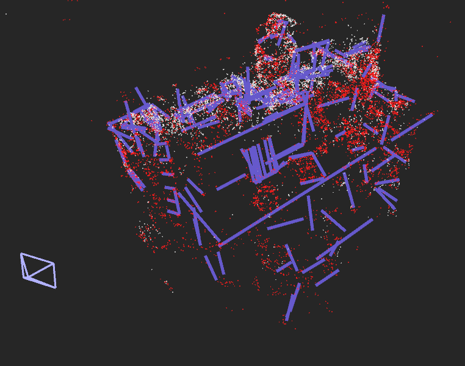
</p>

## Run Point-Plane SLAM (+ Line if Activated, see: planar_mapping_parameters.yaml)

<details>
<summary><b>TUM RGB-D / KITTI / EuRoc MAV</b> (Monocular / RGB-D / Stereo Examples)</summary>

* We provide instance planar segmentation masks and *.txt file, which can be **download** here (OneDrive shared): 
    
    https://1drv.ms/u/s!Atj7rBR0X5zagZwcFs1oIqXeV5r4Cw?e=pbnNES

* TUM RGB-D dataset, besides the folder which saves rgb image, you need to provide folder which saves the segmentation masks and a mask.txt file.
    ```
    ./data/TUM_RGBD/rgbd_dataset_freiburg3_long_office_household/
    |
    |____./rgb/
    |____./depth/
    .
    |____./rgb.txt
    .
    .
    |____./mask/              % given by our download link
    |____./mask.txt           % given by our download link
    ```

* ICL-NUIM dataset, we customize it the same way as TUM RGB-D dataset.
    ```
    ./data/ICL_NUIM/living_room_traj0_frei_png/
    |
    |____./rgb/
    |____./depth/
    .
    .
    |____./mask/              % given by our download link
    .
    |____./rgb.txt            % given by our download link
    |____./depth.txt          % given by our download link
    |____./mask.txt           % given by our download link
    |____./associations.txt   % given by our download link
    |____./groundtruth.txt    % given by our download link
    ```

* EuRoC MAV dataset, we provide necessary segmentation masks in the downloading link, save the segmentation masks under folder **cam0**, e.g.:

    ```
    /data/EuRoC_MAV/V1_02_medium/mav0/cam0/seg/   % given by our download link
    ```

## Run SLAM with Piece-wise Planar Reconstruction 

* Mapping parameters can be adjusted, see **planar_mapping_parameters.yaml**.

### (1) TUM RGB-D (monocular/RGB-D)

```
./build/run_slam_planeSeg \
-v ./orb_vocab/orb_vocab.dbow2 \
-d /data/TUM_RGBD/rgbd_dataset_freiburg3_structure_texture_far \
-c ./example/tum_rgbd/TUM_RGBD_mono_3.yaml
```

### (2) ICL-NUIM (monocular/RGB-D)

```
./build/run_slam_planeSeg \
-v ./orb_vocab/orb_vocab.dbow2 \
-d /data/ICL_NUIM/living_room_traj0_frei_png \
-c ./example/icl_nuim/mono.yaml
```

### (3) EuRoc MAV (monocular/stereo): 
Only V1 and V2 image sequences, due to segmentation CNN failure on factory data sequences MH_01-05, as mentioned in the paper [1].

```
./build/run_euroc_slam_planeSeg \
-v ./orb_vocab/orb_vocab.dbow2 \
-d /data/EuRoC_MAV/V1_01_easy/mav0 \
-c ./example/euroc/EuRoC_stereo.yaml
```

</details>

## Activate Depth-based Dense Reconstruction

It can be easily activated in **planar_mapping_parameters.yaml** -> **Threshold.draw_dense_pointcloud: true**. 

This is a toy demo (RGB-D only).

<p align="center">
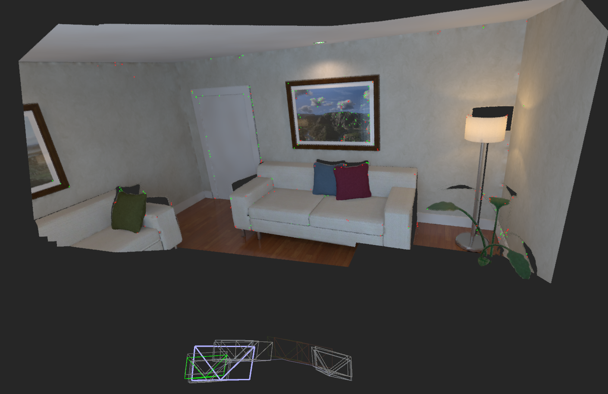
</p>

## Evaluation with EVO tool (https://github.com/MichaelGrupp/evo)

```
evo_ape tum /data/TUM_RGBD/rgbd_dataset_freiburg3_structure_texture_far/groundtruth.txt ./keyframe_trajectory.txt -p --plot_mode=xy -a --verbose -s
```

Important flags:
```
--align or -a = SE(3) Umeyama alignment (rotation, translation)
--align --correct_scale or -as = Sim(3) Umeyama alignment (rotation, translation, scale)
--correct_scale or -s = scale alignment
```

## Debug with GDB

```
gdb ./build/run_slam_planeSeg

run -v ./orb_vocab/orb_vocab.dbow2 -d /data/TUM_RGBD/rgbd_dataset_freiburg3_structure_texture_far -c ./example/tum_rgbd/TUM_RGBD_rgbd_3.yaml
```

### License

* Notice that this work is based on the original OpenVSLAM (renamed now as stella-vslam), which is a derivative work of ORB-SLAM2 without any modification to core algorithms. It was declared in conflict with ORB-SLAM2 (see: https://github.com/stella-cv/stella_vslam/issues/249).

* For the courtesy of ORB-SLAM2, the granted license of this project is **GNU General Public License v3.0**. For commercial purposes of this project, please contact department Augmented Vision (https://www.dfki.de/en/web/research/research-departments/augmented-vision), DFKI (German Research Center for Artificial Intelligence), Germany.

* If you have any **technical questions** regarding to the implementation, please kindly leave an issue.